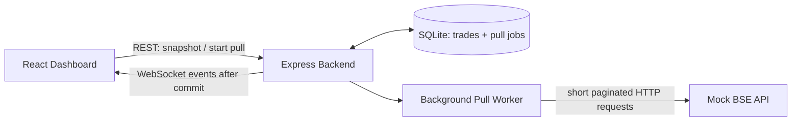

# Architecture

The React dashboard loads a paged SQLite snapshot, then opens `/ws`. A pull request is intentionally short: `POST /api/pulls` writes a queued job and returns `202`; a worker continues independently. The worker reads `/getTrades` page by page, writes each page in a SQLite transaction using the source ID unique constraint, records the offset/checkpoint, and only then broadcasts `trades:batch` and progress events.

The mock splits `MOCK_TOTAL_DELAY_MS` over the page count. Each mock request rejects configurations that would make an individual request exceed the safe 30-second bound; the backend also uses an AbortSignal timeout below 30 seconds. Failed transient requests retry with bounded exponential backoff. Restart recovery queries queued/running jobs and resumes from their persisted offset. Repeating a job or retrying a page is safe because `source_trade_id` is unique.

WebSockets provide push updates and ping/pong liveness. The browser reconnects with bounded exponential backoff and performs a REST reconciliation on reconnect by loading the latest snapshot—there is no interval or browser polling loop. Current limitations: this local assessment implementation has no authentication and does not persist every WebSocket event; reconciliation is a bounded current page refresh rather than an event log cursor.

Successful sequence: queued → running event → page fetch → SQLite transaction → checkpoint → batch/progress event → completed event. A permanently failing page retains earlier committed pages and its checkpoint; after retries are exhausted, the job becomes `failed` with a sanitized message and can be retried.
